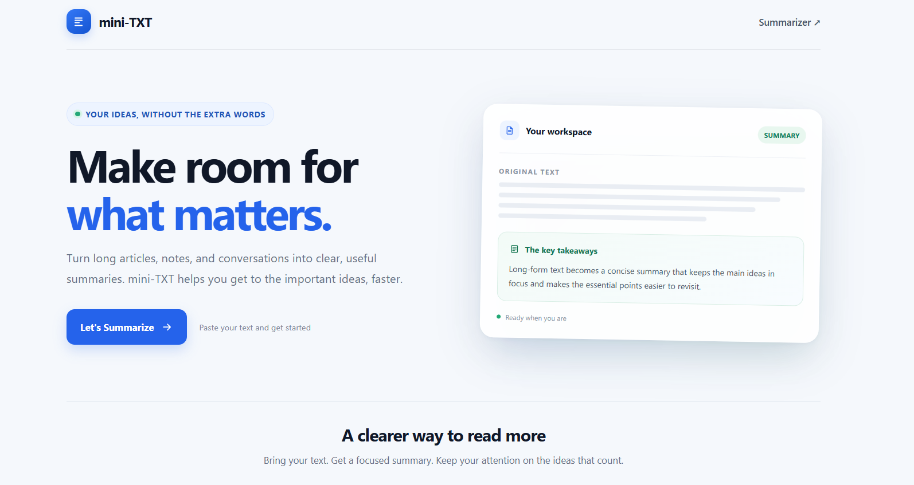
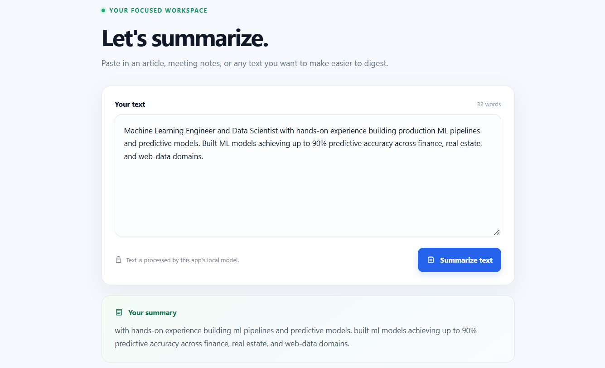

# Mini-TXT

Mini-TXT is a text summarizer built with FastAPI and a local T5 model.

## Setup

Use Python 3.12 and Git LFS. After cloning the repository, install the Python
dependencies and ensure the model file has been downloaded:

```powershell
git lfs install
git lfs pull
python -m pip install -r requirements.txt
```

## Run

Run the app from the repository directory:

```powershell
uvicorn app:app --reload
```

Open <http://127.0.0.1:8000/> in your browser to visit the dashboard. Select
**Let's Summarize** to open the text summarizer. The API accepts `POST
/summarize/` requests with a JSON body such as:

```json
{"dialogue": "Text to summarize"}
```

The app loads its model from `saved_summary_model/` relative to `app.py`.




